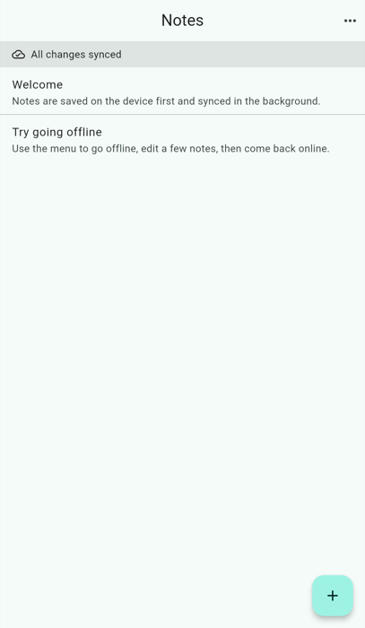

# flutter-offline-notes

[](https://github.com/josephcaughey/flutter-offline-notes/actions/workflows/ci.yml)

A notes app in Flutter that works the same with or without a connection.
Every edit is saved on the device straight away; a small sync engine sends
changes to a server in the background, retries when the network is down, and
handles two devices editing the same note without losing either version.



It runs on iOS, Android and the web. Out of the box it talks to an in-memory
server with a menu to go offline or change a note "from another device", so
the interesting cases can be tried without a backend.

## How sync works

Each note carries three numbers:

- `revision`: the server revision this copy is based on, or none if the
  server has never seen it
- `localVersion`: bumped on every local edit
- `syncedVersion`: the local version the server last accepted

A note is waiting to sync when `localVersion` and `syncedVersion` differ. A
round of sync:

1. **Push** each waiting note with the revision it was based on. The server
   accepts it if its copy is still at that revision, and answers with the new
   revision. Only the version that was sent is marked synced, so an edit made
   while the request was in flight stays waiting.
2. **Resolve conflicts.** If the server's copy has moved on, the server's
   version keeps the note's place and the local text becomes a new
   "(conflict copy)" note, which is pushed next round. Nothing typed is ever
   discarded. A local delete that clashes with a remote edit gives way to the
   edit.
3. **Pull** everything changed since the last cursor. Notes with unpushed
   local edits are skipped; the next push settles them.

Deletes are tombstones, so they sync like any other change. Progress is
saved even when a round fails halfway, so nothing is pushed twice.

Sync runs 0.8 s after typing stops. If the server can't be reached it
retries after 1, 2, 4 … up to 60 seconds; errors that won't fix themselves,
such as a 401, aren't retried.

## The server protocol

`HttpNotesApi` expects two endpoints. Run the app against a real server
with `--dart-define=NOTES_API=https://example.com/api/`.

| request | response |
| --- | --- |
| `GET /notes?since={cursor}` | `{"changes": [note, ...], "cursor": n}` |
| `PUT /notes/{id}` with the note and `baseRevision` | `200 {"revision": n}`, or `409 {"current": note}` if `baseRevision` is stale |

A note is `{id, title, body, updatedAt, deleted, revision}`. Revisions are a
single counter across all notes, which is what lets the cursor work. 5xx,
408, 429 and network failures are retried; other errors are reported.

## Tests

```bash
flutter test
```

31 tests:

- **Sync engine**: pushing, pulling, edits during an in-flight push,
  conflict copies, delete versus edit, tombstones both ways, partial failure,
  restart. One test has two simulated devices make 300 random creates, edits,
  deletes and syncs against one server, then checks both end up with exactly
  the server's notes.
- **Controller**: debounce, exponential backoff and recovery, an edit during
  a sync, run on a fake clock with `fake_async`.
- **HTTP client**: request shapes, 409 handling, which failures are retried,
  using `MockClient`.
- **Storage**: round trips, and unreadable data being kept aside instead of
  overwritten.
- **Widgets**: creating, editing offline and deleting through the real UI.

CI runs formatting, analysis, the tests and a web build on Flutter 3.50.0
and the current stable release.

Needs Flutter 3.50 or later; the UI uses the `material_ui` package that
replaced `package:flutter/material.dart`.

## Layout

```
lib/src/note.dart               the note model
lib/src/note_store.dart         local persistence (SharedPreferences)
lib/src/sync/sync_engine.dart   one round of push, resolve, pull
lib/src/sync/http_notes_api.dart
lib/src/sync/fake_notes_api.dart
lib/src/notes_controller.dart   edits, scheduling, retry and status
lib/src/ui/                     list, editor, sync status line
```

## License

MIT
